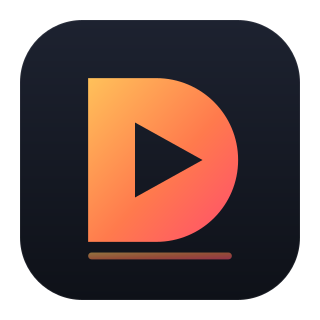

# Debut Pro

A personal, lightweight video editor with a Premiere Pro-style layout and shortcuts.
Debut Pro is a fork of [Shotcut](https://www.shotcut.org/) (GPLv3) by Meltytech, LLC
and contributors; all of Shotcut's editing features come from their work.



## What's different from Shotcut

- **Look:** charcoal dark theme with a blue accent and playhead; Premiere-style
  workspace (Effect Controls and Project panels on the left, Program monitor top
  right, Timeline and audio meters below); workspaces named Assembly, Editing,
  Effects, Color, Audio.
- **Keys and tools:** Premiere-style default shortcuts (Ctrl/Cmd+K add edit,
  Q/W ripple trim, Shift+Delete ripple delete, Ctrl/Cmd+D cross dissolve,
  V selection tool, C razor tool, and more). See `docs/SHORTCUTS.md`.
- **Audio:** *Split Stereo to Left/Right* (like Premiere's breakout to mono) in the
  clip right-click menu, plus *Left Channel Only* / *Right Channel Only* presets.
- **Offline by design:** no update checks, no model or Docker downloads, no HTML
  renderer; the app opens no network ports. Only things you do on purpose (opening a
  stream URL, clicking a Help link) touch the network.
- **Faster defaults:** hardware decoding on, hardware encoder auto-detected the first
  time you open Export (VideoToolbox on Mac, NVENC or AMF on Windows), 720p preview
  scaling for smooth playback (exports stay full resolution).
- **Separate settings:** Debut Pro keeps its own settings and can sit next to Shotcut.
  Project files (.mlt) stay compatible with Shotcut.

## Downloads

Builds come from GitHub Actions (Actions tab → latest run → Artifacts):

- `DebutPro-macos-arm64.dmg`: Apple Silicon, macOS 15 or newer
- `DebutPro-windows-x64.zip`: portable folder, no installer

They are not signed by Apple or Microsoft. On the first launch:

- **Mac:** open the app once, then System Settings → Privacy & Security → *Open Anyway*.
- **Windows:** in the SmartScreen prompt choose *More info* → *Run anyway*.

Details: `docs/BUILDING-DEBUT-PRO.md`.

## License

GPLv3, same as Shotcut. See `COPYING`.

---

# Shotcut - a free, open source, cross-platform **video editor**

<div align="center">


</div>

- Features: https://www.shotcut.org/features/
- Roadmap: https://www.shotcut.org/roadmap/

## Install

Binaries are regularly built and are available at https://www.shotcut.org/download/.

## Contributors

- Dan Dennedy <<http://www.dennedy.org>> : main author
- Brian Matherly <<code@brianmatherly.com>> : contributor

## Dependencies

Shotcut's direct (linked or hard runtime) dependencies are:

- [MLT](https://www.mltframework.org/): multimedia authoring framework
- [Qt 6 (6.4 minimum)](https://www.qt.io/): application and UI framework
- [FFTW](https://fftw.org/)
- [FFmpeg](https://www.ffmpeg.org/): multimedia format and codec libraries
- [Frei0r](https://www.dyne.org/software/frei0r/): video plugins
- [SDL](http://www.libsdl.org/): cross-platform audio playback

See https://shotcut.org/credits/ for a more complete list including indirect
and bundled dependencies.

## License

GPLv3. See [COPYING](COPYING).

## How to build

**Warning**: building Shotcut should only be reserved to beta testers or contributors who know what they are doing.

### Qt Creator

The fastest way to build and try Shotcut development version is through [Qt Creator](https://www.qt.io/download#qt-creator).

### From command line

First, check dependencies are satisfied and various paths are correctly set to find different libraries and include files (Qt, MLT, frei0r and so forth).

#### Configure

In a new directory in which to make the build (separate from the source):

```
cmake -DCMAKE_INSTALL_PREFIX=/usr/local/ /path/to/shotcut
```

We recommend using the Ninja generator by adding `-GNinja` to the above command line.

#### Build

```
cmake --build .
```

#### Install

If you do not install, Shotcut may fail when you run it because it cannot locate its QML
files that it reads at run-time.

```
cmake --install .
```

## Translation

If you want to translate Shotcut to another language, please use [Transifex](https://explore.transifex.com/ddennedy/shotcut/).
